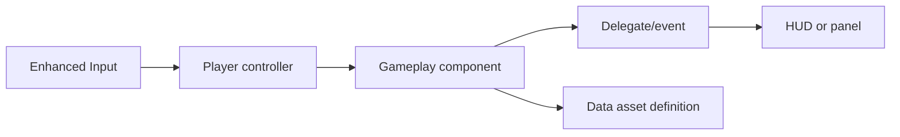

# Architecture and runtime flow

## Ownership

`AActionRPGPlayerCharacter` is the runtime pawn. Its components own separate concerns: inventory/equipment, attributes/derived stats, class and experience, training, skills, trials, ordinary quests, and status effects. `AActionRPGPlayerController` binds Enhanced Input actions, calls gameplay components, and opens panels. HUD/UMG widgets display state and listen to delegates. Data assets configure static definitions; they are not the mutable player state.

| Layer | Examples | Job |
| --- | --- | --- |
| Data | `UClassDataAsset`, `USkillDataAsset`, `UItemDataAsset`, `UTrialDataAsset`, `UQuestDataAsset`, `UCraftingRecipeDataAsset` | Names, requirements, formulas, rewards, costs, and content links |
| State | `UClassComponent`, `UAttributeComponent`, `UInventoryComponent`, `USkillComponent`, `UQuestComponent` | Current selections, balances, items, XP, cooldowns, quest history |
| Gameplay | Skills, projectiles, characters, trigger actors | Validate actions and apply changes through state components |
| Presentation | Controller, HUD, UMG widgets | Input, panels, tooltips, progress, effects, feedback |

The core project source is `Source/ActionRPG/Public` and `Source/ActionRPG/Private`. The main Blueprint pawn and controller are `/Game/Blueprints/Characters/BP_ActionRPGPlayerCharacter` and `/Game/Blueprints/Core/BP_ActionRPGPlayerController`. `/Game/NewMap` contains the current training and trial test setup.

## Typical event paths

- Equipping an item changes `UEquipmentComponent`, which broadcasts `OnEquipmentChanged`; primary and secondary components recalculate, and the equipment panel refreshes.
- A skill action passes through `USkillManagerComponent` into `USkillComponent`. On success it spends resources, starts cooldown, awards use XP, and can report a trial objective. Damage skills then call `TakeDamage` on targets.
- A trial objective reports to `UTrialComponent`. Completion preflights rewards and then changes XP, item inventory, points, or known skills.
- Inventory changes and credited enemy deaths update `UQuestComponent` separately from Trials. Returning to the quest marker preflights and pays the quest reward, then records completion.
- Credited enemy deaths also advance an equipped soulbound weapon's instance-owned growth. The equipment event refreshes damage and UI; ordinary item data stays static.

## Change checklist

1. Locate the owning component and its data asset. Check the live asset path with Unreal MCP.
2. Preserve single ownership of state. Use existing delegates when a widget needs an update.
3. Check whether a rule uses *persistent* or *effective* attributes and whether it requires combined level or a specific class level.
4. Update this reference when behavior changes, then build or use Live Coding as appropriate and verify the affected flow in PIE/MCP automation.

Source: [player character](../../Source/ActionRPG/Public/Characters/ActionRPGPlayerCharacter.h), [controller](../../Source/ActionRPG/Public/Core/ActionRPGPlayerController.h), [game mode](../../Source/ActionRPG/Public/Core/ActionRPGGameMode.h).
